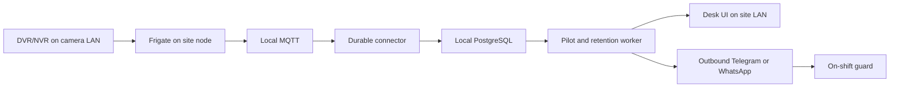

# Restricted-area pilot runbook

## Implemented now

- Local visual review: run `powershell -ExecutionPolicy Bypass -File .\scripts\start-pilot-review.ps1` and open `http://127.0.0.1:8081`. It creates a fresh simulated task in `backend/var/pilot-review-v1.db`; it does not connect a recorder or send real messages. It records its own API/web/worker PIDs under the ignored review log directory.
- Stop those review helpers with `powershell -ExecutionPolicy Bypass -File .\scripts\stop-pilot-review.ps1`; it checks the recorded process command and creation time before stopping anything.

- Guard desk and phone-sized web task view: active queue, event snapshot/clip, instructions, acknowledgement, observed outcome, supervisor label verification and visible delivery failures.
- Single-camera person presence in an engineer-configured Frigate polygon during a site-timezone schedule; one task per source track/rule, including after restart. This detects configured restricted presence, not human authorization or identity.
- Current zone presence is kept distinct from historical entered zones. Finished tracks and stale/backlogged observations cannot create new emergency tasks. The maximum source age defaults to 30 seconds; measure clock synchronization and adjust deliberately.
- Pilot worker skips correlation/ReID and blocks experimental case-study delivery. Pilot API hides replay, mock ingest, parking and experimental case-study routes. Existing research code remains in the repository.
- Desk task exists immediately; assigned guard notification is queued alongside it. Supervisor receives missing-shift/contact, delivery-failure, unacknowledged and need-help escalation. Critical-event copying is an explicit option, off by default.
- Telegram and direct WhatsApp providers record acceptance/failure with bounded retries. Acceptance is not phone receipt or human acknowledgement. Outbox delivery is at least once; a crash after provider acceptance can produce a duplicate message.
- Only incident media is requested in pilot mode; updates share one source-track snapshot/clip instead of copying media per frame. Clips attach when ready and never delay task creation. No source-media URL or recorder secret is returned to the guard.
- Evidence expiry cleanup runs periodically even when jobs are available, audits deletion and respects holds. Default local evidence retention is three days; production requires an explicitly agreed retention setting.
- Public-key file verification is available for local token checks. It retains issuer, audience, expiry and grant checks. This does not implement offline sign-in: deploy/test a local identity service if offline login and session renewal are required.
- Compose translates the host's `DARSON_AUTH_ISSUER/AUDIENCE/JWKS_URL` variables to the backend's actual `DARSON_OIDC_ISSUER/AUDIENCE/JWKS_URL` settings. For a protected public-key file configure `DARSON_OIDC_JWKS_FILE` and mount that file read-only using a site-specific overlay.
- CI runs backend tests, fatal lint checks, frontend tests and build. Site tests, PostgreSQL/RLS and the actual Docker stack remain deployment validation requirements.

## Site node



- Run backend, database, broker, Frigate, connector, jobs and health workers on the site node. The existing Compose overlay now resets inherited public ports and adds outbound recorder and notification network access. No recorder/database port forwarding is needed.
- Frigate alone has the camera-access network; the notification worker has outbound provider access. Docker bridge separation is not a complete LAN firewall policy: the installer must enforce camera-network and host firewall rules.
- Proxy remains bound to loopback port 8080. Serve it through authenticated TLS ingress on the site LAN, with a site certificate trusted by desk and guard devices. Do not expose port 8080 directly to the internet.
- Choose and pin `DARSON_FRIGATE_IMAGE` to the version/digest tested with the actual recorder. Verify browser codecs only if selected-camera live view is added later.
- Configure the same tenant/site on the connector, jobs and health workers. Existing tenant/site isolation is reused, not recreated. Existing camera/post/rule IDs must be globally unique, for example `customer-site-gate`.
- Central multi-site synchronization is deferred. No claim of cloud failover, replication or offline sign-in is made by this change.

## Before any site footage collection

- Record the site owner, security company operations lead, protected door/area, exact recorder/camera model, channel, stream permissions, computer/accelerator, LAN/internet and backup response procedure.
- Obtain a written data-flow decision covering recorder storage, temporary Frigate media, DARSON incident media, diagnostic metadata, labeling/training copies, backups, retention holds, viewing permissions, upload permission and accountable parties. Have counsel determine applicable DPDP requirements; this repository is not a compliance certification.
- Put secrets in protected deployment files or a secret manager. Use a recorder account with only the required stream permissions where supported. Do not place RTSP credentials in examples, Git, browser storage or reports.
- Set `DARSON_PILOT_DATA_AGREEMENT_REF`, the agreed `DARSON_EVIDENCE_RETENTION_DAYS`, a supervisor subject, provider and credentials. Production pilot startup rejects missing agreement reference or a local/no-send provider.
- Configure independent Frigate retention and backup expiry. DARSON's cleanup does not delete recorder recordings or every third-party/backup copy.
- Verify host clock, recorder/source clock and timezone. The software rejects stale/future observations rather than raising delayed emergencies; investigate rejected observations during the site test.

## Engineer configuration

- Configure one Frigate camera and its polygon using Frigate's native tools; track only `person`. Use stable camera/zone IDs and measure actual box/zone updates. DARSON does not write Frigate configuration.
- Apply `alembic upgrade head` under the migration credential before running the restricted application account. New SQLite development databases use metadata creation; existing migration-managed databases must be upgraded. Keep backups and test migration on a copy first.
- Provision guard and supervisor IdP principals with site grants. Register the security post and active shifts using the existing `/api/v1/config/posts` and `/api/v1/config/shifts` APIs.
- Register camera/zone metadata with `POST /api/v1/config/pilot/cameras` using `{"id":"customer-site-gate","name":"Gate","zone_name":"protected"}`. This registers IDs, not a video connection; actual Frigate stream/zone configuration remains a separate verified step.
- Publish the rule with `PUT /api/v1/config/pilot/rules/customer-site-gate-rule`; use the example below and replace its example deadline with the operations lead's agreed value.

```json
{
  "camera_id": "customer-site-gate",
  "zone_name": "protected",
  "post_id": "customer-site-gate-post",
  "schedule": {"weekdays": [0,1,2,3,4,5,6], "start": "22:00", "end": "06:00"},
  "instruction": "Check the gate using the approved site procedure and record what you observed.",
  "acknowledgement_seconds": 60,
  "priority": "high",
  "enabled": true
}
```

- Overnight weekdays refer to the day the window starts; Monday 22:00–06:00 includes Tuesday before 06:00. End times are exclusive. For all-day rules set `all_day:true` with equal start/end. Use the site's stored timezone.
- Publish guard/supervisor contact routing with `PUT /api/v1/config/pilot/contacts/{IdP-subject}`, body `{"channel":"telegram","destination":"approved-chat-id"}` or WhatsApp destination. The subject must already have a site task-role grant; contact values are not returned to guards.
- For Telegram the guard must be able to receive messages from the configured bot. For WhatsApp approve a pilot-specific template with one body text parameter; do not reuse the old experimental three-parameter template. Set a currently supported Graph API version during provider validation.
- Guard desk is the default frontend. Operators can take unassigned tasks; assigned guards/supervisors acknowledge and record real incident, false alarm or need help with a note. A supervisor separately verifies a completed outcome before it is trusted for accuracy review.
- Failed delivery remains visible on the desk. Correct the contact/configuration, then a supervisor can use the retry button or `POST /api/v1/pilot/notices/{id}/retry`. Never equate a successful HTTP request to a human seeing the task.

## Staged acceptance

- Operations lead fills and signs `acceptance.template.json`; all target numbers intentionally start empty. Agree required conditions and repetition counts, detection rate, monitored duration, false-alert rate, alert p95 and acknowledgement p95 before testing.
- Run repeated person entries at the protected area under each agreed condition; also run ordinary allowed movement outside the polygon and outside restricted hours. Include shadows, lights, groups, occlusion and the site's actual night mode.
- Record each expected violation in `trials.template.csv`, including misses as `detected=0`. Alert latency is observed violation to desk alert; acknowledgement time is desk alert to human acknowledgement. Do not enter zero for missing measurements.
- Record independently observed normal operation in `monitoring.template.csv`, with camera-hours and reviewed false alerts. Avoid overlapping/double-counted sessions. Denominators must include quiet hours as well as busy periods.
- Run `python scripts/pilot_acceptance.py --targets <signed-targets.json> --trials <trials.csv> --monitoring <monitoring.csv> --output pilot-results.json`. Missing signatures/targets fail input validation; unmet targets produce a failed report. Staged event detection rate is not generic model accuracy.
- Inspect `GET /api/v1/pilot/metrics` for observed-to-task, task-to-desk-receipt and task-to-acknowledgement p50/p95; source timing depends on clock synchronization, and browser receipt is not human attention.
- On the site node run `python -m app.pilot.probe --seconds 60 --output /tmp/pilot-probe.json` inside the connector container, or an equivalent protected host environment. It reads Frigate version/stats and lifecycle payloads, stores hashed track IDs and timing/field presence, and never stores footage or credentials. It is a diagnostic, not an accuracy benchmark.
- Test stream loss/recovery, broker/database restart, full spool, expiry/holds, failed phone delivery, no guard on shift, an unattended desk, stale actions, expired tokens and internet loss followed by restart/sign-in. Mark offline capability unverified until the actual identity/deployment path passes.
- Operations lead signs the result. Record hardware inference speed, per-camera FPS, skipped frames, CPU/memory and site cost at each tested camera load; do not extrapolate a cameras-per-box limit from one stream.

## ML work

- Establish the pretrained person's baseline before training. Keep separate labels for person detection and restricted-area violation; a correct person detection can still produce a wrong security alert.
- Collect approved misses as well as false alerts. Guard outcome taps are provisional; supervisor verification and reviewed frame boxes/event boundaries form the ground truth.
- Split by camera/day/session, keep adjacent frames in one split and reserve an untouched final test set. Compare per-condition recall/precision and false alerts per camera-hour against the same baseline.
- Tune camera view, polygon and thresholds first. Fine-tune only after a measured residual detection problem remains. Choose local training versus a hosted service according to the written footage policy, hardware and model terms.
- Store model version, dataset/split version, configuration and result; deploy with rollback. Training, hosted upload and an accuracy increase are not claimed by these code changes.

## Next stage

- Line crossing and drawing editor after measuring real trajectory data; validate ordered two-zone entry if dense positions are unavailable.
- Native Android app when its response workflow and maintenance cost are justified by pilot evidence; phone delivery failures require diagnosis before choosing a new channel.
- Optional camera wall, recorder playback integration per tested brand, central multi-site synchronization and periodic reports after site acceptance.

## Reference checks

- Frigate event publications: https://docs.frigate.video/integrations/mqtt/
- Frigate native zones: https://docs.frigate.video/configuration/zones/
- Compose merge/reset/override behavior: https://docs.docker.com/reference/compose-file/merge/
- Frigate code license and separate trademarks: https://github.com/blakeblackshear/frigate — retain required notices for the pinned release; separately review dependencies, chosen models/services and branding before a commercial release.
- Telegram Bot API: https://core.telegram.org/bots/api#sendmessage
